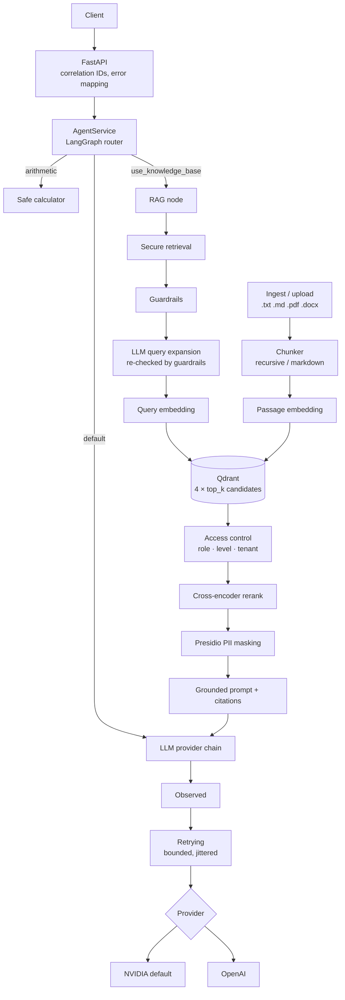

# Aegis AI Platform: Production-Grade Agent Infrastructure

**A platform to build, deploy, observe, evaluate, and operate reliable AI agents.** Aegis pairs a LangGraph
agent with a multi-tenant RAG pipeline and wraps both in production concerns most demos skip: provider
retries, fail-closed retrieval safety, tenant isolation, readiness probes, and per-stage metrics.

**Current release: v0.2.0 (Agent + RAG Foundation).** PostgreSQL persistence (v0.3.0) is in progress.

> 🔒 **The source code is in a private repository.** This page is a public case study of the project.
> Reviewers are welcome to request access; see [Source code access](#-source-code-access).

---

## 📊 Results at a Glance

Numbers come from the project's recorded experiments (live NVIDIA API, local uvicorn, Apple Silicon laptop).
Full tables: [`results/summary.md`](results/summary.md).

| Area | Result | What it means |
|---|---|---|
| ⚡ **Cold start removed from users** | First reranked search **7.4 s → 0.28 s** | Model loading moved to startup; `/health/ready` keeps traffic away until it's done |
| 🧠 **Cost of grounding** | Time to first token **274 ms → 757 ms** (+483 ms) | Almost all of it is retrieval (median 442 ms): one query embedding plus a vector search |
| 🌊 **Streaming** | First chunk in **0.84 s**, vs. 5.7 s for a full non-streamed answer | Users see output ~7× sooner on the same model |
| 🫀 **Non-blocking event loop** | `/health` median **4 ms** (worst 94 ms) during a 3.3 s reranked search | CPU-heavy models (Presidio, cross-encoder) run off the event loop |
| 🔁 **Retry behavior** | **4 / 4** scripted failure scenarios pass | Transient errors recover; persistent ones stop at the attempt limit; streams never retry after output is sent |
| ✅ **Test suite** | **924 tests** (unit, integration, smoke) | Run without API keys; CI gates every change on Ruff, mypy, pytest, and pre-commit |
| 📐 **Design record** | **18 ADRs, 10 RFCs**, PRD, SRS, C4 | Every feature starts as a written decision before code |

Experiment sizes are small (3–10 runs, tiny corpora), so these numbers are indicative, not benchmarks.
Latency is dominated by the live NVIDIA API and varies run to run. Load testing and automated answer-quality
evaluation are on the roadmap.

---

## 🏗️ How It Works

| Layer | Technology |
|---|---|
| API | FastAPI (app factory, SSE streaming, OpenAPI examples), health / readiness / liveness probes |
| Agent | LangGraph routing: calculator, LLM, or knowledge base; real token streaming through the graph |
| LLM | Provider protocol with NVIDIA (default) and OpenAI adapters; retry and observability decorators |
| RAG | Recursive / markdown chunking, NVIDIA and OpenAI embeddings, Qdrant, file upload |
| Safety | Pattern guardrails, role / tenant access control, cross-encoder reranking, Presidio PII masking, hallucination-risk scoring |
| Persistence | PostgreSQL 16, SQLAlchemy 2 async on asyncpg (in progress) |
| Quality | pytest (924 tests), Ruff, mypy, pre-commit, GitHub Actions with a Postgres 16 service |
| Runtime | Python 3.12, uv, Docker, Docker Compose (Qdrant, Postgres) |

---

## 🔬 Engineering Deep Dives

### 1. Retrieval safety that fails closed
Retrieval runs as a fixed pipeline: guardrails → optional LLM query expansion (its output is checked by the
guardrails again) → embedding → over-fetch 4 × `top_k` → **access control** → optional rerank → **PII
masking**. Access control filters on role, access level, and organization *after* the vector search, so
over-fetching keeps results full even when many hits are filtered out. If any safety stage fails, the request
fails; it never falls back to unfiltered results. In a live check, an anonymous caller couldn't see INTERNAL
documents, an email address was masked in both the prompt and the answer, and out-of-corpus questions
returned "I don't know based on the knowledge base." with no citations.

### 2. Finding a cross-tenant overwrite before it shipped
A review of document identity found that chunk IDs didn't include the tenant. A non-admin who ingested a
`doc_id` already used by another organization would **replace that organization's chunks**, and stale-chunk
cleanup would delete the rest. A second path let a signed-in user without an organization header ingest into
*any* tenant. The fix ([ADR-017](docs/decisions.md)): identify documents by `(organization, doc_id)`, derive
point keys from both, filter cleanup and delete by both, include the tenant when merging search hits, and
require non-admins to ingest only into their own organization. No data had been stored with the old IDs, so
no migration was needed.

### 3. Moving a 7-second cold start out of the request path
The first knowledge-base request loaded spaCy (for Presidio) and the cross-encoder, so it took **6–7 s**. An
app factory now warms both models in a worker thread at startup. Liveness still answers in ~1.5 s, readiness
waits for the models (~8.4 s), and the first user search drops to **0.28 s**. The trade-off is documented:
each replica holds both models in memory even if it never reranks.

### 4. Retries that don't corrupt streams
Retries are a provider-neutral decorator. They retry only an allowlist of normalized transient errors, use
bounded exponential backoff with jitter, enforce a total deadline, and propagate cancellation. Streams are
retried **only before the first chunk**: once output has reached the user, a retry would duplicate it, so the
error surfaces instead. A scripted provider proves all four behaviors without network calls.

### 5. Re-ingesting without re-embedding
Each chunk stores a content hash and a fingerprint of the content, access metadata, chunking settings, and
embedding model. Re-ingesting an unchanged document is skipped, so no tokens are spent. Changing any input
re-embeds it. Failures carry a pipeline stage (`chunking`, `embedding`, `storage`, `rerank`,
`pii_masking`, …), which shows up in both the logs and the metrics.

### 6. Settings that were documented but ignored
The chunking settings were documented but never read: the service always used its 1,024 / 128 defaults. The
settings now load from configuration, invalid values stop the app at startup, and the changelog warns users
that settings in their `.env` file now take effect.

---

## 📐 How the Project Is Run

Documentation comes first. Each feature goes through a fixed sequence: requirement → architecture → task
plan → implementation → tests → observability → documentation → commit.

- **PRD and SRS** define scope and requirements; **C4** diagrams cover context, containers, components, and code.
- **10 RFCs** propose designs. Each is reviewed against a checklist, and the outcome is recorded in a review log.
- **18 ADRs** record decisions with alternatives and consequences. Index: [`docs/decisions.md`](docs/decisions.md).
- **Experiments** measure claims before they go in the README. Each has a hypothesis, setup, results, and limitations.

---

## 🧾 Limitations

- **Small experiments.** Latency results come from 3–10 sequential runs on one laptop against a live API.
  They show direction, not capacity.
- **No load testing yet.** Single-process measurements only; concurrency and throughput are planned (W12).
- **Answer quality is checked manually.** Automated grounding and faithfulness evaluation is planned (W11).
- **Hallucination scoring is heuristic.** It flags risk; it doesn't verify claims.

## 🚀 Roadmap

1. **PostgreSQL persistence (v0.3.0):** document registry, ingestion jobs, conversations, and agent runs.
2. **Kafka** event processing.
3. **Docker hardening and Kubernetes** deployment.
4. **OpenTelemetry** export with **Prometheus / Grafana** dashboards.
5. **Automated AI evaluation** (grounding, citation accuracy) and **load testing**.

---

## 🔐 Source Code Access

The full source (API, agent, RAG and safety pipeline, tests, experiments, CI, and design docs) is in a
**private repository**. I'm happy to share it with technical reviewers:

- **GitHub:** [open an access request](../../issues/new?template=access_request.md) with your GitHub username, or
- **LinkedIn:** [KaderBeevi](https://www.linkedin.com/in/kaderbeevi)

Please include your GitHub username so I can add you as a read-only collaborator. I'm also glad to walk through
the code and design decisions on a call.
